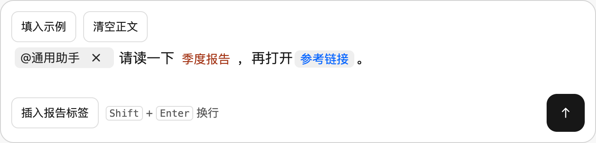
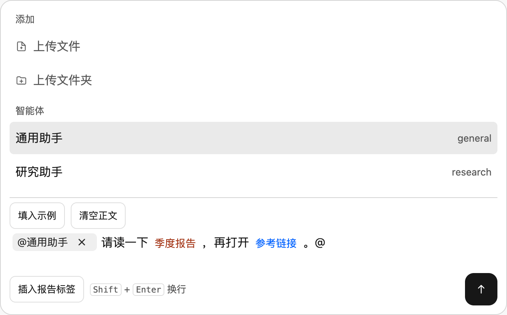

# Vue Agent Input

面向智能体和聊天应用的 Vue 3 输入框。正文支持混排文本、固定标签、可编辑标签和下拉标签，并可通过 `v-model` 保存和回填。通过插槽自定义 `@` 和 `/` 候选，通过事件接入发送与停止操作。





## 安装

在 Vue 3.5 或更新版本的 Vue 3 项目中安装。包提供 ESM、TypeScript 声明和独立 CSS，Chrome 最低支持版本为 90。

```sh
npm install vue-agent-input
```

## 快速开始

从 `vue-agent-input` 导入组件，并在应用中导入一次 `vue-agent-input/style.css`。

```vue
<script setup lang="ts">
import { ref } from 'vue'
import { AgentInput } from 'vue-agent-input'
import type { AgentInputContent, AgentInputSendPayload } from 'vue-agent-input'
import 'vue-agent-input/style.css'

const draft = ref<AgentInputContent>([])

function handleSend({ text }: AgentInputSendPayload) {
  console.log(text)
  draft.value = []
}
</script>

<template>
  <AgentInput v-model="draft" placeholder="输入消息…" @send="handleSend" />
</template>
```

在正文中按 Enter 发送，按 Shift+Enter 换行。空草稿也会触发 `send`，此时 `text` 为 `''`，`content` 为 `[]`。清空草稿后，通过 `v-model:agent` 绑定的智能体仍可继续使用。

## 自定义 `@` 和 `/` 候选

提供 `#suggestion` 插槽后，输入 `@` 或 `/` 会在组件内展开候选。插槽提供触发符和查询词，候选数据与筛选逻辑由调用方提供。下面的示例用 `@` 选择智能体，用 `/` 在光标处插入正文标签。

可通过 `:enable-at-trigger="false"` 或 `:enable-slash-trigger="false"` 单独关闭触发。关闭后对应符号按普通文本输入，调用 `openSuggestion` 也不会打开该候选面板。

```vue
<script setup lang="ts">
import { ref } from 'vue'
import { AgentInput } from 'vue-agent-input'
import type { AgentInputContent, AgentInputExpose, AgentInputItem, AgentInputTag } from 'vue-agent-input'
import 'vue-agent-input/style.css'

const draft = ref<AgentInputContent>([])
const composer = ref<AgentInputExpose | null>(null)
const agent = ref<AgentInputItem | null>(null)
const agents: AgentInputItem[] = [{ label: '研究助手', value: 'research' }]
const tags: AgentInputTag[] = [
  { type: 'tag', label: '季度报告', value: 'report.pdf' },
  { type: 'input', label: '输出语言', value: '中文' },
  {
    type: 'select',
    label: '文章主题',
    value: 'campus',
    options: [
      { label: 'Campus', value: 'campus' },
      { label: 'Travel', value: 'travel' },
    ],
  },
]

function filterCandidates<T extends AgentInputItem>(items: T[], query: string) {
  const keyword = query.toLowerCase()
  return items.filter(item =>
    item.label.toLowerCase().includes(keyword) || item.value.toLowerCase().includes(keyword),
  )
}

function handleTagClick(item: AgentInputTag) {
  console.log(item.value)
}
</script>

<template>
  <button type="button" @click="composer?.openSuggestion('@')">选择智能体</button>
  <button type="button" @click="composer?.openSuggestion('/')">插入标签</button>
  <AgentInput ref="composer" v-model="draft" v-model:agent="agent" @tag-click="handleTagClick">
    <template #suggestion="{ trigger, query, setAgent, insertTag }">
      <button
        v-for="item in filterCandidates(trigger === '@' ? agents : tags, query)"
        :key="item.value"
        type="button"
        @click="trigger === '@' ? setAgent(item) : insertTag(item)"
      >
        {{ item.label }}
      </button>
    </template>
  </AgentInput>
</template>
```

组件外部的按钮或快捷键可以通过 ref 调用 `openSuggestion('@')` 或 `openSuggestion('/')`。面板以空查询打开，光标回到最近的编辑位置。有选区时从选区末尾开始，首次编辑时从正文末尾开始。此时正文保持原样，可以直接输入查询词。

`setAgent(item)` 和 `insertTag(item)` 都会清除当前查询词及正文中的触发符，并恢复正文焦点。`close()` 收起面板并保留已输入的文字。`close({ clearTrigger: true })` 适用于连接器等自定义候选，会清除查询词及正文中的触发符并恢复焦点。

按 Escape 关闭候选面板。需要自定义方向键或 Enter 选择时，监听 `suggestion-keydown`，并对接管的按键调用 `event.preventDefault()`。面板打开时，未接管的 Enter 会收起面板。

## 正文标签与发送数据

`AgentInputContent` 由字符串和 `AgentInputTag` 按顺序组成。通过组件 ref 或候选插槽提供的 `insertTag` 插入。三种标签都支持可选的 `img` 和 `color`，并可用 Backspace 或 Delete 整块删除。

| `type` | 显示与交互 |
| --- | --- |
| `tag`（默认） | 显示 `label`，插入后值固定。 |
| `input` | 显示 `value`，为空时显示 `label` 作为占位文字。编辑框随内容伸缩。按 Enter 或移开焦点保存，按 Escape 取消。 |
| `select` | 显示与 `value` 匹配的选项 `label`。点击展开下拉，也可使用方向键和 Enter 选择。 |

`select` 的 `options` 由 `{ label, value }` 组成，每个选项的 `value` 应唯一。可通过 `value` 预选，或用空字符串展示标签的 `label` 作为占位文字。选择后，`v-model` 更新标签的 `value`，同时保留 `options`。

`send` 的参数为 `{ text, content, agent }`。`text` 将标签展开为 `value`，并在相邻内容缺少空白时补一个空格。空值仍保留在结构化的 `content` 中。`agent` 是当前智能体或 `null`。下面的草稿可以通过 `v-model` 回填，发送时会生成 `请参考 report.pdf 用 中文 写一篇关于 campus 的文章`。

```ts
import type { AgentInputContent } from 'vue-agent-input'

const draft: AgentInputContent = [
  '请参考',
  { type: 'tag', label: '季度报告', value: 'report.pdf' },
  '用',
  { type: 'input', label: '输出语言', value: '中文' },
  '写一篇关于',
  {
    type: 'select',
    label: '文章主题',
    value: 'campus',
    options: [
      { label: 'Campus', value: 'campus' },
      { label: 'Travel', value: 'travel' },
    ],
  },
  '的文章',
]
```

### 升级到 0.3.0

将创建标签时的 `editable: true` 改为 `type: 'input'`。已保存的旧草稿回填时会自动转换。省略 `type` 的普通标签继续按 `tag` 处理。

## API

### Props

| Prop | 类型 | 默认值 | 用途 |
| --- | --- | --- | --- |
| `modelValue` | `AgentInputContent` | `[]` | 通过 `v-model` 绑定草稿。 |
| `agent` | `AgentInputItem \| null` | `null` | 通过 `v-model:agent` 绑定正文首行的智能体。`AgentInputItem` 包含 `label`、`value` 和可选的 `img`。 |
| `theme` | `'light' \| 'dark'` | `'light'` | 选择浅色或深色主题。 |
| `minRows` | `number` | `2` | 正文最少显示的行数。 |
| `maxRows` | `number` | `6` | 正文最多显示的行数，超出时在正文区域内滚动。 |
| `placeholder` | `string` | `'输入消息'` | 正文为空时显示的提示。 |
| `ariaLabel` | `string` | `'消息正文'` | 编辑区的无障碍名称。 |
| `loading` | `boolean` | `false` | 将发送按钮切换为停止按钮。 |
| `enableAtTrigger` | `boolean` | `true` | 控制 `@` 候选是否开启。 |
| `enableSlashTrigger` | `boolean` | `true` | 控制 `/` 候选是否开启。 |

### 事件

| 事件 | 回调参数 | 触发时机 |
| --- | --- | --- |
| `send` | `AgentInputSendPayload` | 点击发送按钮，或在正文中按 Enter 发送。 |
| `stop` | — | `loading` 为 `true` 时点击停止按钮。 |
| `tag-click` | `AgentInputTag` | 点击正文标签，或在标签聚焦时按 Enter 或空格。 |
| `suggestion-keydown` | `KeyboardEvent` | 候选面板打开时收到的正文按键。 |
| `update:modelValue` | `AgentInputContent` | 草稿更新，对应 `v-model`。 |
| `update:agent` | `AgentInputItem \| null` | 选择或移除智能体，对应 `v-model:agent`。 |

接入流式请求时，调用方设置 `loading`，在 `stop` 回调中取消请求，并在请求结束后将 `loading` 恢复为 `false`。

### 插槽

| 插槽 | 位置和用途 |
| --- | --- |
| `header` | 位于正文上方，可放工具栏或已选连接器。 |
| `footer` | 填满发送按钮左侧的可用宽度，两者相隔 `0.5rem`。 |
| `suggestion` | 位于组件内部的 `header` 上方。接收 `{ trigger, query, setAgent, insertTag, close }`，类型为 `AgentInputSuggestion`。最大高度为 `16rem` 和半个视口高度中的较小值，超出时在面板内滚动。 |

### 实例方法

通过 `ref<AgentInputExpose | null>(null)` 获取组件实例。

| 方法 | 用途 |
| --- | --- |
| `focus()` | 将焦点移回正文。 |
| `openSuggestion(trigger)` | 为 `@` 或 `/` 打开 `#suggestion`，并聚焦正文。 |
| `setAgent(item)` | 设置首行智能体，传 `null` 清除。 |
| `insertTag(item)` | 用标签替换当前或最近的正文选区，未建立选区时追加到末尾。 |

## 主题与样式

使用 `theme="dark"` 切换到深色主题。普通标签和首行智能体名称默认使用 `#06f`。可在组件根元素上覆盖 CSS 变量，也可通过单个正文标签的 `color` 设置文字颜色。

```vue
<AgentInput
  theme="dark"
  style="--agent-input-tag-color: #8ab4ff; --agent-input-tag-background: #303846"
/>
```

| CSS 变量 | 用途 |
| --- | --- |
| `--agent-input-surface`、`--agent-input-text`、`--agent-input-border`、`--agent-input-focus` | 输入框背景、正文、边框与焦点颜色。 |
| `--agent-input-agent-color` | 智能体标签的 `@` 与名称颜色。 |
| `--agent-input-tag-color`、`--agent-input-tag-background` | 普通标签文字和悬停背景，也用于输入标签的编辑态背景。 |
| `--agent-input-select-color`、`--agent-input-select-background`、`--agent-input-select-highlight` | 下拉标签文字、背景与选项高亮。 |

## 本地开发

```sh
npm install
npm run dev
npm run typecheck
npm run build:demo
npx playwright install chromium webkit
npm test
```

运行 `npm pack` 会先构建组件库，再生成包含 JavaScript、CSS、类型声明和 `LICENSE` 的本地安装包。

## 许可证

MIT © 2026 originRing
